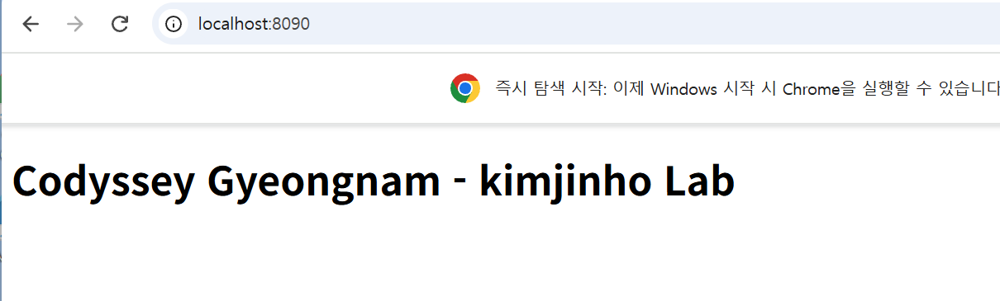
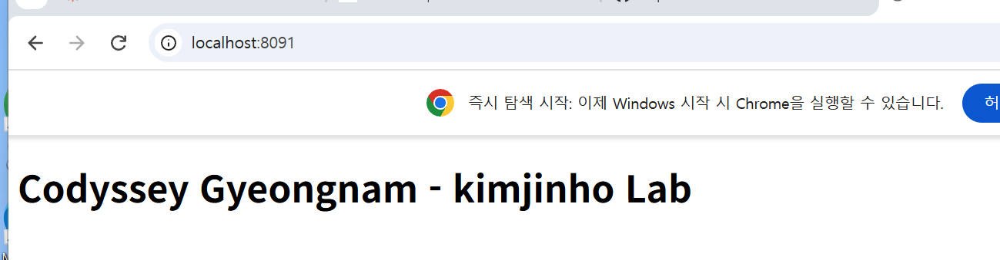
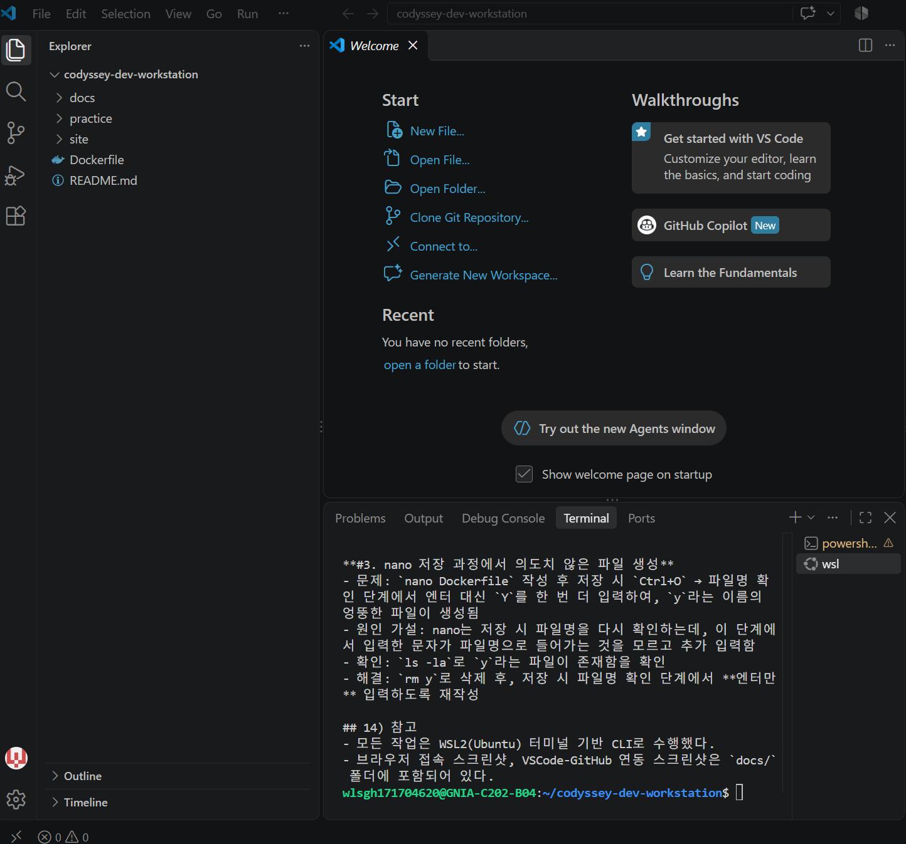

# Codyssey 경남 — 개발 워크스테이션 구축 (터미널 / Docker / Git)

## 1) 프로젝트 개요
터미널 기본 조작과 파일 권한을 익히고, WSL2(Ubuntu) 환경에 Docker Engine을 직접 설치하여 nginx 기반 커스텀 웹서버 이미지를 제작했다. 포트 매핑, 바인드 마운트, 볼륨 영속성을 직접 검증했다.

## 2) 실행 환경
- OS: Windows (WSL2 - Ubuntu 26.04.1 LTS)
- Kernel: 6.18.54.1-microsoft-standard-WSL2
- Shell: bash
- Docker: 29.9.2 (Docker Engine - Community)
- Git: 2.53.0

## 3) 수행 체크리스트
- [x] 터미널 기본 조작 (이동/생성/복사/이동/삭제/내용확인)
- [x] 파일 1개 + 디렉토리 1개 권한 변경 실습
- [x] Docker 설치 (WSL2 Ubuntu에 Docker Engine 직접 설치) 및 점검
- [x] hello-world 컨테이너 실행
- [x] ubuntu 컨테이너 진입 및 명령 수행
- [x] 기존 nginx 베이스 이미지 기반 커스텀 Dockerfile 작성/빌드
- [x] 포트 매핑 접속 (8090, 8091 — 2회, 브라우저 증거 포함)
- [x] 바인드 마운트 반영 검증
- [x] Docker 볼륨 영속성 검증
- [x] Git 설정 + VSCode GitHub 연동

## 4) Docker/Git 설치 점검

```bash
$ docker --version
Docker version 29.9.2, build a82e528

$ git --version
git version 2.53.0

$ docker info
Server:
 Containers: 2
 Images: 2
 Server Version: 29.9.2
 Storage Driver: overlayfs
 Operating System: Ubuntu 26.04.1 LTS
 Kernel Version: 6.18.54.1-microsoft-standard-WSL2
 Architecture: x86_64
 CPUs: 24
 Total Memory: 15.25GiB
```

## 5) 터미널 기본 조작 로그

```bash
$ mkdir practice
$ cd practice

$ pwd
/home/wlsgh171704620/codyssey-dev-workstation/practice

$ touch a.txt

$ ls -la
total 8
drwxr-xr-x 2 wlsgh171704620 wlsgh171704620 4096 Nov  3 11:22 .
drwxr-xr-x 4 wlsgh171704620 wlsgh171704620 4096 Nov  3 11:21 ..
-rw-r--r-- 1 wlsgh171704620 wlsgh171704620    0 Nov  3 11:22 a.txt

$ cp a.txt b.txt
$ mv b.txt c.txt
$ cat a.txt
$ touch empty.txt
$ rm c.txt

$ ls -la
total 8
drwxr-xr-x 2 wlsgh171704620 wlsgh171704620 4096 Nov  3 11:22 .
drwxr-xr-x 4 wlsgh171704620 wlsgh171704620 4096 Nov  3 11:21 ..
-rw-r--r-- 1 wlsgh171704620 wlsgh171704620    0 Nov  3 11:22 a.txt
-rw-r--r-- 1 wlsgh171704620 wlsgh171704620    0 Nov  3 11:22 empty.txt
```

## 6) 권한 실습 (변경 전/후)

```bash
# 파일 권한 변경 전
$ ls -l a.txt
-rw-r--r-- 1 wlsgh171704620 wlsgh171704620 0 Nov  3 11:22 a.txt

# 파일 권한 변경
$ chmod 600 a.txt

# 파일 권한 변경 후
$ ls -l a.txt
-rw------- 1 wlsgh171704620 wlsgh171704620 0 Nov  3 11:22 a.txt

# 디렉토리 권한 변경 전
$ mkdir testdir
$ ls -ld testdir
drwxr-xr-x 2 wlsgh171704620 wlsgh171704620 4096 Nov  3 11:23 testdir

# 디렉토리 권한 변경
$ chmod 700 testdir

# 디렉토리 권한 변경 후
$ ls -ld testdir
drwx------ 2 wlsgh171704620 wlsgh171704620 4096 Nov  3 11:23 testdir
```

- `600`: 소유자만 읽기/쓰기 가능(rw-------), 그룹/기타 접근 불가
- `700`: 소유자만 읽기/쓰기/실행 가능(rwx------), 그룹/기타 완전 접근 차단

## 7) Docker 기본 운영 명령 + 컨테이너 실행

```bash
$ docker images
IMAGE                ID             DISK USAGE
hello-world:latest   c567b231f656   25.9kB
ubuntu:latest        6a06111c3b0a   163MB

$ docker run hello-world
Hello from Docker!
This message shows that your installation appears to be working correctly.

$ docker run --name ubuntu-test ubuntu bash -c "ls / && echo hello-from-container"

$ docker logs ubuntu-test
bin boot dev etc home lib lib64 media mnt opt proc root run sbin srv sys tmp usr var
hello-from-container

$ docker ps -a
CONTAINER ID   IMAGE         STATUS                      NAMES
76c37810b255   ubuntu        Exited (0) 21 minutes ago   ubuntu-test
b94006c3693c   hello-world   Exited (0) 21 minutes ago   adoring_elion

$ docker run -d --name stats-test2 ubuntu sleep 300
$ docker stats --no-stream
CONTAINER ID   NAME          CPU %   MEM USAGE / LIMIT    MEM %
ad1bcb259852   stats-test2   0.00%   3.02MiB / 15.25GiB   0.02%
```

- `docker run ubuntu <cmd>`는 명령 종료와 함께 컨테이너도 `Exited` 상태가 됨 (1회성 실행)
- `-d`로 백그라운드 실행한 프로세스는 계속 `Up` 상태를 유지하므로 로그/리소스 확인이 가능함

## 8) 커스텀 웹서버 Dockerfile (기존 nginx 베이스 활용)

- 베이스: `nginx:alpine`
- 커스텀 포인트:
  - `LABEL`로 작성자 명시
  - `ENV APP_ENV=dev` 환경변수 추가
  - 정적 콘텐츠(`site/index.html`) 교체

```dockerfile
FROM nginx:alpine
LABEL maintainer="jinho"
ENV APP_ENV=dev
COPY site/ /usr/share/nginx/html
```

## 9) 포트 매핑 접속 증거

```bash
$ docker build -t my-custom-nginx:1.0 .
...
Successfully built

$ docker run -d -p 8090:80 --name my-nginx my-custom-nginx:1.0
$ docker run -d -p 8091:80 --name my-nginx-2 my-custom-nginx:1.0
```

브라우저에서 아래 주소로 각각 접속하여 주소창이 포함된 스크린샷을 저장했다.

- `http://localhost:8090` → 
- `http://localhost:8091` → 

## 10) 바인드 마운트 반영 검증

```bash
$ docker run -d -p 8092:80 --name my-nginx-bind -v "$(pwd)/site":/usr/share/nginx/html my-custom-nginx:1.0

# 변경 전
$ curl http://localhost:8092
<h1>Codyssey Gyeongnam - kimjinho Lab</h1>

# 호스트 파일만 수정 (컨테이너 재시작 없음)
$ echo "<p>Updated via bind mount!</p>" >> site/index.html

# 변경 후 — 즉시 반영됨
$ curl http://localhost:8092
<h1>Codyssey Gyeongnam - kimjinho Lab</h1>
<p>Updated via bind mount!</p>
```

바인드 마운트는 호스트 디렉토리를 컨테이너 내부 경로에 직접 연결한다. 따라서 컨테이너를 재시작하지 않아도 호스트의 파일 수정 내용이 즉시 컨테이너에 반영됨을 확인했다.

## 11) Docker 볼륨 영속성 검증

```bash
$ docker volume create mydata
$ docker run -d --name vol-test -v mydata:/data ubuntu sleep infinity
$ docker exec vol-test bash -c "echo hi > /data/hello.txt && cat /data/hello.txt"
hi

$ docker rm -f vol-test

$ docker run -d --name vol-test2 -v mydata:/data ubuntu sleep infinity
$ docker exec vol-test2 bash -c "cat /data/hello.txt"
hi
```

컨테이너 `vol-test`를 삭제한 뒤 새 컨테이너 `vol-test2`에 같은 볼륨 `mydata`를 연결했다. 그 결과 `/data/hello.txt` 내용이 그대로 유지되어 Docker 볼륨의 영속성을 확인했다.

## 12) Git 설정

아래 출력은 개인정보 보호를 위해 이메일 일부를 마스킹했다.

```bash
$ git config --global user.name "jinho"
$ git config --global user.email "jinhog177@g***.com"
$ git config --global init.defaultBranch main

$ git config --list
user.name=jinho
user.email=jinhog177@g***.com
init.defaultbranch=main
core.repositoryformatversion=0
core.filemode=true
core.bare=false
core.logallrefupdates=true
```

VSCode에서 GitHub 계정 로그인 및 저장소 연동을 완료했다.



## 13) 트러블슈팅

### #1. WSL2 Ubuntu 설치 중 비밀번호 불일치 에러
- 문제: `wsl --install -d Ubuntu` 진행 중 `New password` / `Retype new password` 입력 시 `Sorry, passwords do not match` 에러 발생
- 원인 가설: 두 번 입력한 비밀번호가 실제로 일치하지 않았음. 리눅스 터미널은 비밀번호 입력 시 화면에 아무 표시가 없어 오타를 인지하기 어려움
- 확인: `Try again? [y/N]` 프롬프트에서 `y` 입력 후 재시도
- 해결: 비밀번호를 신중히 재입력하여 `passwd updated successfully` 확인 후 정상 진행

### #2. Dockerfile COPY 경로 오타로 인한 콘텐츠 미반영
- 문제: `COPY site/ /user/share/nginx/html`로 작성함 (`usr` → `user` 오타)
- 원인 가설: nginx의 실제 정적 콘텐츠 경로는 `/usr/share/nginx/html`인데, 오타로 인해 엉뚱한 경로(`/user/...`)에 파일이 복사됨
- 확인: `cat Dockerfile`로 `COPY` 경로를 재확인하여 오타 발견
- 해결: `/usr/share/nginx/html`로 정정 후 이미지를 재빌드하여 정상 동작 확인

### #3. nano 저장 과정에서 의도치 않은 파일 생성
- 문제: `nano Dockerfile` 작성 후 저장 시 `Ctrl + O` → 파일명 확인 단계에서 엔터 대신 `Y`를 한 번 더 입력하여 `y`라는 이름의 엉뚱한 파일이 생성됨
- 원인 가설: nano는 저장 시 파일명을 다시 확인하는데, 이 단계에서 입력한 문자가 파일명으로 들어가는 것을 모르고 추가 입력함
- 확인: `ls -la`로 `y`라는 파일이 존재함을 확인
- 해결: `rm y`로 삭제 후, 저장 시 파일명 확인 단계에서 엔터만 입력하도록 재작성

## 14) 프로젝트 구조

```
.
├── Dockerfile
├── README.md
├── site/
│   └── index.html
└── docs/
    ├── port-8090.png
    ├── port-8091.png
    └── vscode-github.png
```

## 15) 참고
- 모든 작업은 WSL2(Ubuntu) 터미널 기반 CLI로 수행했다.
- 브라우저 접속 스크린샷과 VSCode-GitHub 연동 스크린샷은 `docs/` 폴더에 포함되어 있다.
