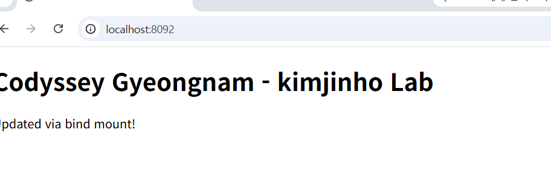
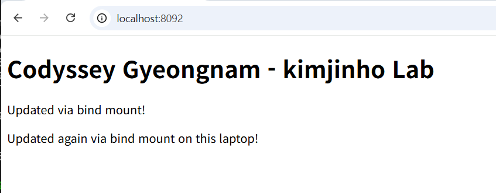
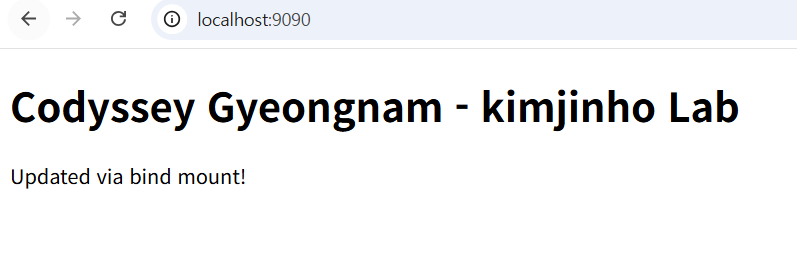

# Codyssey 경남 — 개발 워크스테이션 구축 (터미널 / Docker / Git)

## 목차

1. [프로젝트 개요](#1-프로젝트-개요)
2. [실행 환경](#2-실행-환경)
3. [수행 체크리스트](#3-수행-체크리스트)
4. [검증 방법과 증거 위치](#4-요구사항별-검증-방법과-증거-위치)
5. [Docker/Git 설치 점검](#5-dockergit-설치-점검)
6. [터미널 기본 조작](#6-터미널-기본-조작-로그)
7. [권한 실습](#7-권한-실습-변경-전후)
8. [Docker 기본 운영과 컨테이너 실행](#8-docker-기본-운영-명령--컨테이너-실행)
9. [커스텀 웹 서버 Dockerfile](#9-커스텀-웹서버-dockerfile-기존-nginx-베이스-활용)
10. [포트 매핑 접속](#10-포트-매핑-접속-증거)
11. [바인드 마운트](#11-바인드-마운트-반영-검증)
12. [Docker 볼륨 영속성](#12-docker-볼륨-영속성-검증)
13. [Git 설정과 GitHub 연동](#13-git-설정)
14. [트러블슈팅](#14-트러블슈팅)
15. [재현 절차](#15-재현-절차-reproduction)
16. [추가 실습 완료 내역](#16-추가-실습-완료-내역)
17. [프로젝트 구조](#17-프로젝트-구조)
18. [보너스 과제](#18-보너스-과제)
19. [참고](#19-참고)

## 1) 프로젝트 개요
터미널 기본 조작과 파일 권한을 익히고, WSL2(Ubuntu) 환경에서 Docker를 설치·점검한 뒤 nginx 기반 커스텀 웹서버 이미지를 제작했다. 포트 매핑, 바인드 마운트, 볼륨 영속성을 직접 실행 결과로 검증했다. Git 사용자 설정과 GitHub 연동까지 포함해, 코드가 "내 컴퓨터에서만" 동작하는 문제를 줄이고 재현 가능한 개발 환경을 구성하는 것을 목표로 했다.

## 2) 실행 환경
- OS: Windows (WSL2 - Ubuntu 26.04.1 LTS)
- Kernel: 6.18.54.1-microsoft-standard-WSL2
- Shell: bash
- Docker: 29.9.2
- Git: 2.53.0
- 터미널 애플리케이션: **Ubuntu 앱(Microsoft Store 배포판 전용 터미널)**

> **환경 확정**: §6~§13의 재현 실습 로그는 Windows 노트북에서 **Docker Desktop(WSL2 Integration)** 을 통해 Ubuntu WSL 배포판의 `docker` CLI로 수행한 결과다. WSL2를 활성화하고(`wsl --install`), Docker Desktop을 D드라이브에 설치한 뒤(`--installation-dir=D:\Docker --wsl-default-data-root=D:\DockerData`), Ubuntu 배포판을 기본값으로 지정(`wsl --set-default Ubuntu`)하고 Docker Desktop 설정에서 WSL Integration을 켜서 연동했다. §5의 `docker info` 출력에서 `Operating System: Docker Desktop`, `Name: docker-desktop`으로 이 사실이 직접 확인된다. 최초 README의 "Docker Engine - Community" 표기는 다른(클라우드) 환경에서의 기록이며, 본 재현 작업과는 별개 환경이다.

## 3) 수행 체크리스트
- [x] 터미널 기본 조작 (pwd / ls -la / cd / mkdir / cp / mv / cat / touch / rm)
- [x] 파일 1개 + 디렉토리 1개 권한 변경 실습
- [x] Docker 버전 확인 (`docker --version`)
- [x] Docker 데몬 동작 확인 (`docker info`)
- [x] Docker 이미지 다운로드 로그 (`docker pull`) — [§8-4](#8-4-이미지-다운로드pull--컨테이너-중지stop-기록) 참고
- [x] Docker 이미지 목록 확인 (`docker images`)
- [x] 컨테이너 실행 (`docker run`)
- [x] 컨테이너 중지 기록 (`docker stop` 전/후 상태 비교) — [§8-4](#8-4-이미지-다운로드pull--컨테이너-중지stop-기록) 참고
- [x] 컨테이너 목록 확인 (`docker ps -a`)
- [x] 컨테이너 로그 확인 (`docker logs`)
- [x] 리소스 확인 (`docker stats`)
- [x] hello-world 컨테이너 실행 성공
- [x] ubuntu 컨테이너 대화형 셸(`-it`) 진입 — [§8-5](#8-5-ubuntu-컨테이너-대화형-셸-진입) 참고
- [x] 컨테이너 종료/유지(주 프로세스 종료 vs `docker exec` 셸 종료) 차이 관찰 — [§8-6](#8-6-컨테이너-종료유지--exec-셸-종료-vs-주-프로세스-종료-비교) 참고
- [x] 기존 nginx 베이스 이미지 기반 커스텀 Dockerfile 작성/빌드
- [x] 포트 매핑 접속 (8090, 8091 — 2회, 브라우저 증거 포함, 이 노트북에서 재현)
- [x] 바인드 마운트 반영 검증 (이 노트북에서 재현)
- [x] Docker 볼륨 영속성 검증 (이 노트북에서 재현)
- [x] Git 사용자 정보/기본 브랜치 설정 + `git config --list` 기록
- [x] GitHub 로그인/저장소 연동 증거 — [§13-2](#13-2-github--vscode-연동-증거) 참고 (스크린샷 교체 완료)
- [x] (보너스) Docker Compose 기초(단일 서비스 실행) — [§18-1](#18-1-docker-compose-기초) 참고
- [x] (보너스) Docker Compose 멀티 컨테이너(네트워크 통신 확인) — [§18-2](#18-2-docker-compose-멀티-컨테이너) 참고
- [x] (보너스) Compose 운영 명령어(up/down/ps/logs) — [§18-3](#18-3-compose-운영-명령어-up--down--ps--logs) 참고
- [x] (보너스) 환경 변수로 설정과 코드 분리(포트 변경) — [§18-4](#18-4-환경-변수로-포트-변경-설정과-코드의-분리) 참고
- [x] (보너스) GitHub SSH 키 설정 및 인증 확인 — [§18-5](#18-5-github-ssh-키-설정) 참고

## 4) 요구사항별 검증 방법과 증거 위치

| 요구 항목 | 검증 명령 | 결과 위치 |
|---|---|---|
| 터미널 기본 조작 | `pwd`, `ls -la`, `cd`, `cp`, `mv`, `cat`, `touch`, `rm` | [§6](#6-터미널-기본-조작-로그) |
| 파일/디렉토리 권한 변경 | `chmod 600`/`700` 전/후 `ls -l` | [§7](#7-권한-실습-변경-전후) |
| Docker 버전/데몬 점검 | `docker --version`, `docker info` | [§5](#5-dockergit-설치-점검) |
| 이미지 목록 확인 | `docker images` | [§8](#8-docker-기본-운영-명령--컨테이너-실행) |
| 컨테이너 목록/로그/리소스 | `docker ps -a`, `docker logs`, `docker stats` | [§8](#8-docker-기본-운영-명령--컨테이너-실행) |
| hello-world 실행 | `docker run hello-world` | [§8](#8-docker-기본-운영-명령--컨테이너-실행) |
| 커스텀 이미지 빌드 | `docker build` | [§9](#9-커스텀-웹서버-dockerfile-기존-nginx-베이스-활용) |
| 커스텀 이미지 컨테이너 실행 | `docker run -d -p ...` | [§10](#10-포트-매핑-접속-증거) |
| 포트 매핑 접속 | 브라우저 `localhost:8090`, `localhost:8091` | [§10](#10-포트-매핑-접속-증거), [docs/port-8090.png](./docs/port-8090.png), [docs/port-8091.png](./docs/port-8091.png) |
| 바인드 마운트 반영 | `localhost:8092` 변경 전/후 스크린샷 비교 | [§11](#11-바인드-마운트-반영-검증) |
| 볼륨 영속성 | 컨테이너 재생성 후 `cat /data/hello.txt` | [§12](#12-docker-볼륨-영속성-검증) |
| Git 설정 | `git config --list` | [§13](#13-git-설정) |
| GitHub 연동 | VSCode 계정 패널 스크린샷 | [docs/vscode-github.png](./docs/vscode-github.png) |
| 이미지 다운로드(pull) | `docker pull ubuntu` | [§8-4](#8-4-이미지-다운로드pull--컨테이너-중지stop-기록) |
| 컨테이너 중지 | `docker stop stop-test` | [§8-4](#8-4-이미지-다운로드pull--컨테이너-중지stop-기록) |
| 대화형 셸 진입 | `docker run -it ubuntu bash` | [§8-5](#8-5-ubuntu-컨테이너-대화형-셸-진입) |
| 종료 방식 차이 | `docker exec` 셸 종료 vs `docker stop` | [§8-6](#8-6-컨테이너-종료유지--exec-셸-종료-vs-주-프로세스-종료-비교) |
| GitHub push 동기화 확인 | `git remote -v`, `git fetch origin`, `git status -sb` | [§13-1](#13-1-git과-github의-역할-차이) |
| Compose 기초(단일 서비스) | `docker compose up -d web` | [§18-1](#18-1-docker-compose-기초) |
| Compose 멀티 컨테이너(네트워크 통신) | `docker compose exec helper wget -qO- http://web` | [§18-2](#18-2-docker-compose-멀티-컨테이너) |
| Compose 운영 명령어 | `docker compose logs`, `down`, `ps` | [§18-3](#18-3-compose-운영-명령어-up--down--ps--logs) |
| 환경 변수로 포트 변경 | `.env`의 `WEB_PORT` 수정 후 `docker compose up -d` | [§18-4](#18-4-환경-변수로-포트-변경-설정과-코드의-분리), [docs/compose-port-9090.png](./docs/compose-port-9090.png) |
| GitHub SSH 키 설정 | `ssh-keygen`, `ssh -T git@github.com` | [§18-5](#18-5-github-ssh-키-설정) |

## 5) Docker/Git 설치 점검

```bash
$ docker --version
Docker version 29.9.2, build a82e528

$ git --version
git version 2.53.0

$ docker info
Server:
 Containers: 8
  Running: 4
  Paused: 0
  Stopped: 4
 Images: 4
 Server Version: 29.9.2
 Storage Driver: overlayfs
 Logging Driver: json-file
 Cgroup Driver: cgroupfs
 Cgroup Version: 2
 Kernel Version: 6.18.54.1-microsoft-standard-WSL2
 Operating System: Docker Desktop
 OSType: linux
 Architecture: x86_64
 CPUs: 8
 Total Memory: 7.463GiB
 Name: docker-desktop
 Docker Root Dir: /var/lib/docker
 Debug Mode: false
```
(위는 이 노트북에서 재실행한 결과이며, 길이가 긴 출력 중 핵심 라인만 발췌했다. `Operating System: Docker Desktop`, `Name: docker-desktop`을 통해 이 환경이 Docker Desktop(WSL Integration)임이 직접 확인된다.)

## 6) 터미널 기본 조작 로그

```bash
$ mkdir practice
$ cd practice

$ pwd
/home/wlsgh171704620/codyssey-dev-workstation/practice

$ touch a.txt

$ ls -la
total 8
drwxr-xr-x 2 wlsgh171704620 wlsgh171704620 4096 Nov  3 11:22 .
drwxr-xr-x 4 wlsgh171704620 wlsgh171704620 4096 Nov  3 11:21 ..
-rw-r--r-- 1 wlsgh171704620 wlsgh171704620    0 Nov  3 11:22 a.txt

$ cp a.txt b.txt
$ mv b.txt c.txt
$ cat a.txt
$ touch empty.txt
$ rm c.txt

$ ls -la
total 8
drwxr-xr-x 2 wlsgh171704620 wlsgh171704620 4096 Nov  3 11:22 .
drwxr-xr-x 4 wlsgh171704620 wlsgh171704620 4096 Nov  3 11:21 ..
-rw-r--r-- 1 wlsgh171704620 wlsgh171704620    0 Nov  3 11:22 a.txt
-rw-r--r-- 1 wlsgh171704620 wlsgh171704620    0 Nov  3 11:22 empty.txt
```

### 6-1) 절대 경로 vs 상대 경로
- 위 로그에서 `pwd`가 출력한 `/home/wlsgh171704620/codyssey-dev-workstation/practice`는 루트(`/`)부터 시작하는 **절대 경로**다. 항상 같은 위치를 가리킨다.
- 반면 `cd practice`, `cat a.txt`처럼 현재 위치를 기준으로 쓴 경로는 **상대 경로**다. 예를 들어 `practice` 디렉토리 안에서 `cat a.txt`를 실행하면 실제로는 `/home/.../codyssey-dev-workstation/practice/a.txt`를 가리키지만, 현재 위치가 바뀌면 같은 `a.txt`라는 상대 경로도 다른 파일을 가리킬 수 있다.

## 7) 권한 실습 (변경 전/후)

```bash
# 파일 권한 변경 전
$ ls -l a.txt
-rw-r--r-- 1 wlsgh171704620 wlsgh171704620 0 Nov  3 11:22 a.txt

# 파일 권한 변경
$ chmod 600 a.txt

# 파일 권한 변경 후
$ ls -l a.txt
-rw------- 1 wlsgh171704620 wlsgh171704620 0 Nov  3 11:22 a.txt

# 디렉토리 권한 변경 전
$ mkdir testdir
$ ls -ld testdir
drwxr-xr-x 2 wlsgh171704620 wlsgh171704620 4096 Nov  3 11:23 testdir

# 디렉토리 권한 변경
$ chmod 700 testdir

# 디렉토리 권한 변경 후
$ ls -ld testdir
drwx------ 2 wlsgh171704620 wlsgh171704620 4096 Nov  3 11:23 testdir
```

### 7-1) 권한 표기 설명
- 권한은 `r(읽기)=4`, `w(쓰기)=2`, `x(실행/탐색)=1`의 합으로 숫자 하나에 표현된다. 자릿수는 순서대로 **소유자 / 그룹 / 기타 사용자**다.
- `755` = 소유자 `rwx`(7) · 그룹 `r-x`(5) · 기타 `r-x`(5) — 소유자만 쓰기 가능, 나머지는 읽기/실행만 가능
- `644` = 소유자 `rw-`(6) · 그룹 `r--`(4) · 기타 `r--`(4) — 일반 파일에 흔히 쓰는 조합
- `600` (본 실습의 `a.txt`) = 소유자만 `rw-`, 그룹/기타는 완전 차단
- `700` (본 실습의 `testdir`) = 소유자만 `rwx`, 그룹/기타는 완전 차단
- 디렉토리의 `x`는 "내부 목록을 보는 권한(`r`)"과는 별개로, **그 디렉토리 안으로 들어가거나(`cd`) 내부 파일에 실제로 접근하기 위한 권한**이다. `r`만 있고 `x`가 없으면 `ls`로 이름은 보여도 `cd`나 파일 열람은 거부된다.

## 8) Docker 기본 운영 명령 + 컨테이너 실행

```bash
$ docker images
IMAGE                ID             DISK USAGE
hello-world:latest   c567b231f656   25.9kB
ubuntu:latest        6a06111c3b0a   163MB

$ docker run hello-world
Hello from Docker!
This message shows that your installation appears to be working correctly.

$ docker run --name ubuntu-test ubuntu bash -c "ls / && echo hello-from-container"

$ docker logs ubuntu-test
bin boot dev etc home lib lib64 media mnt opt proc root run sbin srv sys tmp usr var
hello-from-container

$ docker ps -a
CONTAINER ID   IMAGE         STATUS                      NAMES
76c37810b255   ubuntu        Exited (0) 21 minutes ago   ubuntu-test
b94006c3693c   hello-world   Exited (0) 21 minutes ago   adoring_elion

$ docker run -d --name stats-test2 ubuntu sleep 300
$ docker stats --no-stream
CONTAINER ID   NAME          CPU %   MEM USAGE / LIMIT    MEM %
ad1bcb259852   stats-test2   0.00%   3.02MiB / 15.25GiB   0.02%
```

### 8-1) 이미지 vs 컨테이너
**이미지**는 실행에 필요한 파일/설정을 담은 변경 불가능한 템플릿이고, **컨테이너**는 그 이미지를 기반으로 실제 실행된 격리 프로세스다. 하나의 이미지로 여러 컨테이너를 동시에 띄울 수 있다 (실제로 본 실습에서도 `my-custom-nginx:1.0` 이미지 하나로 `my-nginx`, `my-nginx-2` 두 컨테이너를 각각 실행했다, §10).

### 8-2) 백그라운드 실행과 컨테이너 생명주기
`-d`는 컨테이너를 백그라운드(detached)로 실행하는 옵션이다. 컨테이너는 **주 프로세스(PID 1)가 종료되면 함께 종료(Exited)**된다. 위 로그에서 `docker run --name ubuntu-test ubuntu bash -c "..."`가 명령을 마치자마자 `Exited` 상태가 된 것이 이 때문이고, 반대로 `sleep 300`처럼 즉시 끝나지 않는 프로세스를 주 프로세스로 실행하면 컨테이너는 `Up` 상태를 유지한다.

### 8-3) docker exec
`docker exec`는 **이미 실행 중인 컨테이너 내부에 별도의 추가 프로세스를 실행**하는 명령이다. 주 프로세스와 독립적이므로, `docker exec`로 연 셸을 종료해도 컨테이너의 주 프로세스가 살아있다면 컨테이너 자체는 계속 실행 상태를 유지한다. (직접 비교 실습은 §8-6 참고)

### 8-4) 이미지 다운로드(pull) + 컨테이너 중지(stop) 기록

```bash
$ docker pull ubuntu
Using default tag: latest
latest: Pulling from library/ubuntu
f3f25b84a7d7: Pull complete
edafa32f5d9e: Pull complete
21594acc2d8b: Download complete
Digest: sha256:6a06111c3b0a8600feadb270aec771dc239bf407b25625f93f44ab00e11f4d3c
Status: Downloaded newer image for ubuntu:latest
docker.io/library/ubuntu:latest
```

```bash
$ docker run -d --name stop-test ubuntu sleep 300
701dcee82b89ef370aed6b7f544297f138daa7ef59922ea0ff2edee1b39f371b

$ docker ps
CONTAINER ID   IMAGE    COMMAND       CREATED         STATUS          NAMES
701dcee82b89   ubuntu   "sleep 300"   12 seconds ago  Up 11 seconds   stop-test

$ docker stop stop-test
stop-test

$ docker ps -a
CONTAINER ID   IMAGE    COMMAND       CREATED         STATUS                       NAMES
701dcee82b89   ubuntu   "sleep 300"   25 seconds ago  Exited (137) 5 seconds ago   stop-test
```

`docker stop`을 실행하자 `Up` 상태였던 컨테이너가 `Exited (137)`로 바뀐 것을 확인했다.

### 8-5) Ubuntu 컨테이너 대화형 셸 진입

```bash
$ docker run -it --name ubuntu-interactive-v2 ubuntu bash
root@0e9b549be8ac:/# ls /
bin   dev  home  lib64  mnt   proc  run   srv  tmp  var
boot  etc  lib   media  opt   root  sbin  sys  usr
root@0e9b549be8ac:/# echo hello-from-container
hello-from-container
root@0e9b549be8ac:/# exit
exit
```

프롬프트가 `root@0e9b549be8ac:/#` 형태로 바뀐 것이 컨테이너 내부 대화형 셸에 실제로 진입했다는 증거이며, `ls /`와 `echo hello-from-container`의 실제 출력도 위와 같이 확인했다. `exit`로 셸을 나오자 주 프로세스(bash)가 함께 종료되어 컨테이너도 `Exited` 상태가 되었다.

### 8-6) 컨테이너 종료/유지 — exec 셸 종료 vs 주 프로세스 종료 비교

```bash
$ docker run -d --name lifecycle-test nginx:alpine
$ docker exec -it lifecycle-test sh -c "echo inside-exec; exit"
inside-exec

$ docker ps
CONTAINER ID   IMAGE          COMMAND                   CREATED          STATUS          PORTS     NAMES
24f6b839c049   nginx:alpine   "/docker-entrypoint.…"    16 seconds ago   Up 15 seconds   80/tcp    lifecycle-test
```

`docker exec`로 연 셸을 종료했지만 컨테이너는 여전히 `Up` 상태다. exec 셸 종료가 컨테이너 자체에는 영향을 주지 않음을 확인했다.

```bash
$ docker stop lifecycle-test
$ docker ps -a
CONTAINER ID   IMAGE          COMMAND                   CREATED          STATUS                      PORTS   NAMES
24f6b839c049   nginx:alpine   "/docker-entrypoint.…"    53 seconds ago   Exited (0) 5 seconds ago            lifecycle-test
```

이번에는 주 프로세스를 직접 종료(`docker stop`)하자 컨테이너가 `Exited`로 바뀌었다. 두 결과를 비교하면, **`docker exec`로 실행한 추가 프로세스의 종료는 컨테이너 상태에 영향을 주지 않지만, 주 프로세스의 종료(또는 `docker stop`)는 컨테이너를 정지시킨다**는 차이가 명확히 드러난다. (`docker stop`은 컨테이너에 설정된 종료 신호(기본 SIGTERM)를 보내고 정해진 유예 시간 내에 종료되지 않으면 SIGKILL로 강제 종료하는 방식이라, "즉시" 멈추는 것은 아니다.)

## 9) 커스텀 웹서버 Dockerfile (기존 nginx 베이스 활용)

```dockerfile
FROM nginx:alpine
LABEL maintainer="진호"
ENV APP_ENV=dev
COPY site/ /usr/share/nginx/html
```

- 베이스: `nginx:alpine`
- 선택 이유: alpine 기반이라 이미지 용량이 작고, nginx가 정적 콘텐츠 서빙 용도로 이미 구성되어 있어 "기존 이미지 기반 커스텀"이라는 요구사항에 바로 부합한다.
- 커스텀 포인트별 목적:
  - `LABEL maintainer="진호"`: 이미지 메타데이터에 작성자 정보를 기록 (운영/검색 목적, 빌드·실행 동작에는 영향 없음)
  - `ENV APP_ENV=dev`: 컨테이너 내부에 환경변수를 설정. **다만 이 변수는 현재 Dockerfile이나 nginx 설정 어디에서도 실제로 참조되지 않으므로, nginx의 동작 방식이나 실행 모드를 자동으로 바꾸지는 않는다.** 환경변수 주입 방법 자체를 보여주기 위한 선언적 커스텀 포인트다.
  - `COPY site/ /usr/share/nginx/html`: nginx의 기본 정적 콘텐츠 디렉토리를 프로젝트 `site/`의 내용으로 교체

```bash
$ cat Dockerfile
FROM nginx:alpine
LABEL maintainer="진호"
ENV APP_ENV=dev
COPY site/ /usr/share/nginx/html

$ docker build -t my-custom-nginx:1.0 .
[+] Building 1.4s (7/7) FINISHED                                    docker:default
 => [internal] load build definition from Dockerfile              0.0s
 => [internal] load metadata for docker.io/library/nginx:alpine   0.1s
 => [internal] load build context                                 0.1s
 => => transferring context: 190B                                 0.0s
 => [1/2] FROM docker.io/library/nginx:alpine@sha256:785835ea...  0.8s
 => [2/2] COPY site/ /usr/share/nginx/html                        0.1s
 => exporting to image                                            0.2s
 => => naming to docker.io/library/my-custom-nginx:1.0            0.0s
 => => unpacking to docker.io/library/my-custom-nginx:1.0         0.0s
```
(위 출력은 실제 빌드 로그 중 핵심 라인만 발췌한 것이며, 레이어 추출 등 세부 라인은 생략했다)

## 10) 포트 매핑 접속 증거

```bash
$ docker run -d -p 8090:80 --name my-nginx my-custom-nginx:1.0
$ docker run -d -p 8091:80 --name my-nginx-2 my-custom-nginx:1.0
```

`-p 8090:80`은 "호스트의 8090번 포트 → 컨테이너의 80번 포트" 연결을 의미한다. 컨테이너는 기본적으로 격리된 네트워크 네임스페이스에 있다. 이번 환경에서는 localhost로 접속하기 위해 포트를 매핑했다 — 포트 매핑으로 호스트와 컨테이너를 연결해야 브라우저(호스트)에서 컨테이너 내부 nginx(80번 포트 대기)에 접근할 수 있다.

브라우저에서 아래 주소로 각각 접속하여 주소창이 포함된 스크린샷을 저장했다 (이 노트북에서 재현한 결과로 교체).

- `http://localhost:8090` → 
- `http://localhost:8091` → 

> 참고: 화면에 "Updated via bind mount!" 문구가 함께 보이는 이유는, `site/index.html`이 이전(클라우드) 작업에서 바인드 마운트 테스트로 이미 수정된 상태로 git에 커밋되어 있고, 본 노트북에서 그 파일을 그대로 `docker build`에 사용했기 때문이다. 포트 매핑 자체의 접속 성공 여부와는 무관하며, 파일 내용이 그대로 이미지에 반영된 정상적인 결과다.

## 11) 바인드 마운트 반영 검증

```bash
$ docker run -d -p 8092:80 --name my-nginx-bind -v "$(pwd)/site":/usr/share/nginx/html my-custom-nginx:1.0
```

변경 전 (`http://localhost:8092`, 이전 작업에서 추가된 "Updated via bind mount!" 문구까지가 당시 파일 상태):



```bash
# 호스트 파일만 수정 (컨테이너 재시작 없음)
$ echo "<p>Updated again via bind mount on this laptop!</p>" >> site/index.html
```

변경 후 — 컨테이너 재시작 없이 새로고침만으로 즉시 반영됨:



바인드 마운트는 호스트 디렉토리를 컨테이너 내부 경로에 직접 연결한다. 컨테이너를 재시작하지 않아도 호스트의 파일 수정 내용이 즉시 컨테이너에 반영됨을 이 노트북에서도 동일하게 재확인했다.

> 재현 시 주의: 위 `$(pwd)` 명령은 **프로젝트 루트에서 WSL bash로 실행**해야 한다. 다른 셸(PowerShell 등)에서는 `$(pwd)` 문법이 동일하게 동작하지 않는다.

### 11-1) 재검증 시 주의사항

위 §11의 명령과 변경 전/후 증거는 그 실습을 실행했던 당시의 기록 그대로이며, 수정하지 않았다. 다만 이 기록을 그대로 다시 재현하려는 경우 주의할 점이 있다.

**현재 `site/index.html`에는 이미 "변경 후" 문구(`Updated via bind mount!`, `Updated again via bind mount on this laptop!`)가 `<body>` 안에 들어가 있는 상태다.** 이 상태에서 §11에 적힌 것과 **똑같은 `echo "..." >> site/index.html` 명령을 그대로 다시 실행하면**, 기존 문구에 더해 **같은 내용이 중복으로 추가**되고, `</html>` 태그 뒤에 새 줄이 붙게 된다 (`echo >>`는 HTML 구조를 이해하지 못하고 파일 맨 끝에 단순히 텍스트를 추가하는 명령이기 때문이다).

위 로그는 최초 실습 당시의 기록이며, 아래는 재검증 방법에 대한 안내다:

1. `echo ... >>`로 새 줄을 추가하는 대신, **`<body>` 안에 있는 기존 문구 자체를 새로운 내용으로 수정**한다 (예: `sed` 또는 `nano`로 기존 `<p>` 태그의 텍스트를 교체).
2. 컨테이너를 재시작하지 않고 **브라우저를 새로고침**해서, 바뀐 내용이 바로 반영되는지 확인한다 (바인드 마운트이므로 호스트 파일 수정이 컨테이너에도 즉시 반영된다 — 이 원리 자체는 §11의 기존 실습에서 이미 확인한 것과 동일하다).

## 12) Docker 볼륨 영속성 검증

```bash
$ docker volume create mydata
mydata

$ docker run -d --name vol-test -v mydata:/data ubuntu sleep infinity
11e140e3df0a541abb6fabd7064eba69cd4cf309f27c9bad44812b59936525e0

$ docker exec vol-test bash -c "echo hi > /data/hello.txt && cat /data/hello.txt"
hi

$ docker rm -f vol-test
vol-test

$ docker run -d --name vol-test2 -v mydata:/data ubuntu sleep infinity
daf5ac96c5c2e0d8a17dfffca56c94224de0c3e2cf6e870472037a589299a34c

$ docker exec vol-test2 bash -c "cat /data/hello.txt"
hi
```

컨테이너 `vol-test`를 삭제한 뒤 새 컨테이너 `vol-test2`에 같은 볼륨 `mydata`를 연결했다. `/data/hello.txt` 내용이 그대로 유지되어 Docker 볼륨의 영속성을 이 노트북에서도 재확인했다.

### 12-1) 바인드 마운트 vs Docker 볼륨
- **바인드 마운트**는 **호스트의 특정 경로를 직접 지정**해서 컨테이너 내부 경로에 연결한다. 호스트 파일을 직접 수정하면 컨테이너 재시작 없이 즉시 반영됨을 §11에서 확인했다. 데이터의 실체가 호스트 파일 시스템 그 자체이므로, 컨테이너를 삭제해도 그 호스트 경로의 파일은 당연히 그대로 남는다.
- **Docker 볼륨**은 호스트 경로를 사람이 직접 지정하지 않고, **Docker가 자체적으로 관리하는 저장 영역**에 데이터를 둔다. 컨테이너를 삭제해도 볼륨 자체는 Docker가 별도로 보관하고 있어, 새 컨테이너에 같은 볼륨을 연결하면 데이터가 유지됨을 본 섹션에서 확인했다.
- 핵심 차이는 "삭제 후에도 데이터가 남는지" 여부가 아니라(둘 다 남는다), **데이터가 저장되는 위치를 사용자가 직접 지정하는가(바인드 마운트) 아니면 Docker가 관리하는가(볼륨)**에 있다. 바인드 마운트는 호스트와의 실시간 동기화·공유에 적합하고, 볼륨은 컨테이너 환경과 분리된 Docker 전용 데이터 저장에 적합하다.

## 13) Git 설정

아래 출력은 개인정보 보호를 위해 이메일 일부를 마스킹했다. **마스킹된 값은 문서 표시용이며, 실제 설정 명령에 그대로 입력할 수 있는 값이 아니다.**

```bash
$ git config --global user.name "jinho"
$ git config --global user.email "jinhog177@g***.com"
$ git config --global init.defaultBranch main

$ git config --list
user.name=jinho
user.email=jinhog177@g***.com
init.defaultbranch=main
core.repositoryformatversion=0
core.filemode=true
core.bare=false
core.logallrefupdates=true
```

### 13-1) Git과 GitHub의 역할 차이
- **Git**은 로컬 컴퓨터에서 파일 변경 이력을 관리하는 버전 관리 도구다. `git config`, `git add`, `git commit`은 모두 로컬에서 동작한다.
- **GitHub**는 이 Git 저장소를 원격에 호스팅하고 협업(Pull Request, Issue 등)을 지원하는 플랫폼이다. 로컬 저장소를 GitHub에 올리려면 `git remote add origin ...`, `git push`처럼 원격 연동 과정이 추가로 필요하다.

저장소가 GitHub에 실제로 연동·동기화되어 있음을 아래 명령으로 확인했다.

```bash
$ git remote -v
origin  https://github.com/jinho1017-eng/codyssey-dev-workstation-E1-1.git (fetch)
origin  https://github.com/jinho1017-eng/codyssey-dev-workstation-E1-1.git (push)
```

`git log --oneline`만으로는 로컬에 저장된 원격 추적 정보(`origin/main`)를 보는 것이라 GitHub의 실시간 상태를 보장하지 않는다. 그래서 `git fetch`로 원격의 최신 상태를 직접 받아온 뒤 비교했다.

```bash
$ git fetch origin
$ git status -sb
## main...origin/main
```

`git fetch` 이후에도 `main...origin/main` 사이에 ahead/behind 표시나 변경 파일 목록이 전혀 없다는 것은, 로컬 `main` 브랜치와 GitHub의 `origin/main`이 실제로 같은 상태이고 커밋되지 않은 변경사항도 없다는 뜻이다. 이 결과로 로컬 저장소와 GitHub 원격 저장소의 동기화를 확인했다. (최초 `git remote add origin`·`git push` 작업 자체는 이 저장소가 생성된 시점에 수행된 것으로, 그 시점의 터미널 출력 로그는 별도로 보존되어 있지 않다.)

### 13-2) GitHub / VSCode 연동 증거


VSCode 계정 메뉴에 `jinho1017-eng (GitHub)` 계정이 로그인되어 있는 것이 확인된다. 이 노트북에서 다시 캡처하여 교체한 스크린샷이다.

## 14) 트러블슈팅

### #1. WSL2 Ubuntu 설치 중 비밀번호 불일치 에러
- 문제: `wsl --install -d Ubuntu` 진행 중 `New password` / `Retype new password` 입력 시 `Sorry, passwords do not match` 에러 발생
- 원인 가설: 두 번 입력한 비밀번호가 실제로 일치하지 않았음. 리눅스 터미널은 비밀번호 입력 시 화면에 아무 표시가 없어 오타를 인지하기 어려움
- 확인: `Try again? [y/N]` 프롬프트에서 `y` 입력 후 재시도
- 해결: 비밀번호를 신중히 재입력하여 `passwd updated successfully` 확인 후 정상 진행

### #2. Dockerfile COPY 경로 오타로 인한 콘텐츠 미반영
- 문제: `COPY site/ /user/share/nginx/html`로 작성함 (`usr` → `user` 오타)
- 원인 가설: nginx의 실제 정적 콘텐츠 경로는 `/usr/share/nginx/html`인데, 오타로 인해 엉뚱한 경로(`/user/...`)에 파일이 복사됨
- 확인: `cat Dockerfile`로 `COPY` 경로를 재확인하여 오타 발견
- 해결: `/usr/share/nginx/html`로 정정 후 이미지를 재빌드하여 정상 동작 확인

### #3. nano 저장 과정에서 의도치 않은 파일 생성
- 문제: `nano Dockerfile` 작성 후 저장 시 `Ctrl + O` → 파일명 확인 단계에서 엔터 대신 `Y`를 한 번 더 입력하여 `y`라는 이름의 엉뚱한 파일이 생성됨
- 원인 가설: nano는 저장 시 파일명을 다시 확인하는 단계가 있는데, 이 단계에서 입력한 문자가 그대로 파일명으로 들어간 것으로 추정됨 (정확한 내부 동작은 추가 확인 필요)
- 확인: `ls -la`로 `y`라는 파일이 존재함을 확인
- 해결: `rm y`로 삭제 후, 저장 시 파일명 확인 단계에서 엔터만 입력하도록 재작성

## 15) 재현 절차 (Reproduction)

```bash
git clone https://github.com/jinho1017-eng/codyssey-dev-workstation-E1-1.git
cd codyssey-dev-workstation-E1-1

# 이미지 빌드
docker build -t my-custom-nginx:1.0 .

# 컨테이너 실행
docker run -d -p 8090:80 --name my-nginx my-custom-nginx:1.0

# 접속 확인
curl http://localhost:8090
# 또는 브라우저에서 http://localhost:8090 접속
```

- 바인드 마운트 재현 시 `$(pwd)` 명령은 반드시 **프로젝트 루트에서 WSL bash**로 실행해야 한다.
- §5~§13의 실습은 이 노트북에서 **Docker Desktop(WSL Integration)** 환경으로 재현한 결과다.

## 16) 추가 실습 완료 내역

아래 항목들은 최초 제출본에서 증거가 부족했던 부분으로, 이 노트북에서 모두 재실행하여 보완했다. 실행 결과는 각 항목이 표시된 섹션에 직접 반영했다.

| 항목 | 반영 위치 |
|---|---|
| 이미지 다운로드(`docker pull`) 로그 | §8-4 |
| 컨테이너 중지(`docker stop`) 전/후 비교 | §8-4 |
| Ubuntu 컨테이너 대화형 셸 진입 | §8-5 |
| 컨테이너 종료/유지(exec 셸 종료 vs 주 프로세스 종료) 비교 | §8-6 |
| GitHub 연동 스크린샷 재캡처 | §13-2 |
| GitHub push 동기화 확인 | §13-1 |
| 포트 매핑 2회 접속 스크린샷 재촬영 | §10 |
| 바인드 마운트 재검증 | §11 |
| 볼륨 영속성 재검증 | §12 |

## 17) 프로젝트 구조

```text
.
├── Dockerfile
├── docker-compose.yml
├── .env
├── README.md
├── site/
│   └── index.html
└── docs/
    ├── port-8090.png
    ├── port-8091.png
    ├── vscode-github.png
    ├── bind-mount-before.png
    ├── bind-mount-after.png
    └── compose-port-9090.png
```

## 18) 보너스 과제

> 아래 18-1~18-5는 항목별 기록이며 시간순이 아니다. 현재 `.env`의 `WEB_PORT`는 `9090`이고, `8095`는 과거 실습 당시의 값이다.

### 18-1) Docker Compose 기초

`docker-compose.yml`에 두 개의 서비스를 정의했다: 아까 만든 커스텀 nginx 이미지를 쓰는 `web`과, 18-2에서 쓸 보조 컨테이너 `helper`(alpine). 이 `docker-compose.yml`은 이미지를 빌드(`build:`)하지 않고 **이미 로컬에 존재하는 이미지 이름**(`my-custom-nginx:1.0`)을 그대로 참조하는 방식이다. 따라서 새 환경에서 재현하려면 Compose를 실행하기 전에 반드시 그 이미지를 먼저 빌드해야 한다.

```yaml
services:
  web:
    image: my-custom-nginx:1.0
    container_name: compose-web
    ports:
      - "${WEB_PORT}:80"
    environment:
      - APP_ENV=${APP_ENV}

  helper:
    image: alpine:latest
    container_name: compose-helper
    command: sleep infinity
    depends_on:
      - web
```

```bash
# Compose 실행 전 이미지 빌드 선행 (§9와 동일)
$ docker build -t my-custom-nginx:1.0 .
```

"기초" 단계로서, `web` 서비스 하나만 지정해서 실행했다 (`helper`는 `web`에 의존하는 쪽이라 지정하지 않으면 같이 뜨지 않는다):

```bash
$ docker compose down
$ docker compose up -d web
$ docker compose ps
[+] up 2/2
 ✔ Network codyssey-dev-workstation-e1-1_default   Created
 ✔ Container compose-web                           Started

NAME          IMAGE                 COMMAND                  SERVICE   STATUS   PORTS
compose-web   my-custom-nginx:1.0   "/docker-entrypoint.…"   web       Up       0.0.0.0:9090->80/tcp, [::]:9090->80/tcp
```

`compose-web`만 떴고 `compose-helper`는 뜨지 않은 것으로, `web` 단일 서비스만 지정해서 실행했음을 확인했다. (포트가 `9090`으로 보이는 것은 §18-4에서 `.env`의 `WEB_PORT`를 `8095` → `9090`으로 바꾼 뒤이기 때문이며, 최초 실행 시점에는 `8095`였다.)

### 18-2) Docker Compose 멀티 컨테이너

18-1과는 별도로, 서비스 지정 없이 `docker compose up -d`를 실행해서 `docker-compose.yml`에 정의된 **두 서비스(`web`, `helper`)를 함께** 띄웠다 (이때는 `.env`의 `WEB_PORT`가 아직 `8095`였던 시점이다).

```bash
$ docker compose up -d
[+] up 7/7
 ✔ Image alpine:latest                               Pulled   5.6s
 ✔ Network codyssey-dev-workstation-e1-1_default      Created  0.1s
 ✔ Container compose-web                              Started  0.5s
 ✔ Container compose-helper                           Started  0.6s

$ docker compose ps
NAME             IMAGE                 COMMAND                  SERVICE   STATUS   PORTS
compose-helper   alpine:latest         "sleep infinity"         helper    Up
compose-web      my-custom-nginx:1.0   "/docker-entrypoint.…"   web       Up       0.0.0.0:8095->80/tcp, [::]:8095->80/tcp
```

이 상태에서 **컨테이너 간 네트워크 통신**을 확인했다 — `helper` 컨테이너에서 IP 주소가 아니라 Compose 서비스 이름(`web`)만으로 `web` 컨테이너에 접근:

> 용어 구분: `docker-compose.yml`에서 서비스 이름은 `web`이고, 실제 컨테이너 이름은 `container_name: compose-web`으로 별도 지정했다. Docker Compose는 **서비스 이름**을 내부 DNS로 등록해주기 때문에, 아래 `wget` 요청은 (실제 컨테이너 이름인 `compose-web`이 아니라) 서비스 이름 `web`로 보냈다.

```bash
$ docker compose exec helper wget -qO- http://web
<!doctype html>
<html>
<body>
<h1>Codyssey Gyeongnam - kimjinho Lab</h1>
</body>
</html>
<p>Updated via bind mount!</p>
```

`helper`가 IP 주소가 아니라 서비스 이름(`web`)만으로 요청을 보낼 수 있었다는 것은, Docker Compose가 같은 프로젝트의 서비스들을 위해 자동으로 전용 네트워크와 내부 DNS(서비스명 → 컨테이너 IP)를 구성해준다는 증거다.

> 위 `wget` 결과에 보이는 HTML은 `</html>` 뒤에 `<p>` 태그가 있는 구조 수정 전 버전이다. 이 이미지(`my-custom-nginx:1.0`)가 §19에서 설명한 HTML 구조 수정 이전에 빌드된 것이기 때문이며, 포트/네트워크 확인이라는 이 실습의 목적과는 무관하다.

### 18-3) Compose 운영 명령어 (up / down / ps / logs)

```bash
$ docker compose logs web --tail 5
compose-web  | 172.18.0.1 - - [03/Nov/2026:08:01:14 +0000] "GET / HTTP/1.1" 200 120 "-" "curl/8.18.0" "-"
compose-web  | 172.18.0.3 - - [03/Nov/2026:08:01:21 +0000] "GET / HTTP/1.1" 200 120 "-" "Wget" "-"
compose-web  | 172.18.0.1 - - [03/Nov/2026:08:01:42 +0000] "GET / HTTP/1.1" 200 120 "-" "Mozilla/5.0 ..." "-"
compose-web  | 2026/11/03 08:01:42 [error] 33#33: *3 open() "/usr/share/nginx/html/favicon.ico" failed (2: No such file or directory), ...
compose-web  | 172.18.0.1 - - [03/Nov/2026:08:01:42 +0000] "GET /favicon.ico HTTP/1.1" 404 555 "http://localhost:8095/" "Mozilla/5.0 ..." "-"

$ docker compose down
[+] down 3/3
 ✔ Container compose-helper                        Removed
 ✔ Container compose-web                           Removed
 ✔ Network codyssey-dev-workstation-e1-1_default    Removed

$ docker compose ps
NAME   IMAGE   COMMAND   SERVICE   CREATED   STATUS   PORTS
```

`logs`로 각 요청(curl, wget, 브라우저)의 접속 기록까지 확인했고, `down`으로 컨테이너와 네트워크가 깔끔히 정리된 뒤 `ps`가 빈 목록을 반환하는 것도 확인했다.

### 18-4) 환경 변수로 포트 변경 (설정과 코드의 분리)

`.env` 파일에 `WEB_PORT`를 정의해서 `docker-compose.yml`이 이 값을 읽도록 구성했다.

```bash
# .env (최초)
WEB_PORT=8095
APP_ENV=dev
```

`.env`의 `WEB_PORT`를 `9090`으로 바꾸고 다시 `docker compose up -d`를 실행했다. Dockerfile이나 코드는 전혀 건드리지 않았다.

```bash
$ docker compose up -d
[+] up 3/3
 ✔ Network codyssey-dev-workstation-e1-1_default   Created
 ✔ Container compose-web                           Started
 ✔ Container compose-helper                        Started

$ docker compose ps
NAME             IMAGE                 COMMAND                  SERVICE   STATUS   PORTS
compose-helper   alpine:latest         "sleep infinity"         helper    Up
compose-web      my-custom-nginx:1.0   "/docker-entrypoint.…"   web       Up       0.0.0.0:9090->80/tcp, [::]:9090->80/tcp
```

`docker compose ps`의 `PORTS` 란에서 `9090`으로 바뀐 것을 확인했고, 터미널 `curl`이 아니라 **브라우저로 직접 접속해서** 주소창과 응답 화면을 함께 캡처했다:



`.env` 파일 하나만 바꿨는데 서비스에 접속하는 포트가 `8095`에서 `9090`으로 바뀌었다. 이때 바뀐 것은 **호스트(이 노트북)에 공개되는 포트**이고, `docker-compose.yml`의 `"${WEB_PORT}:80"`에서 뒤쪽 `80`(컨테이너 내부에서 nginx가 듣는 포트)은 그대로다 — 즉 컨테이너 내부 설정이 아니라 "호스트와 컨테이너를 연결하는 입구"만 설정값으로 바뀐 것이다. 이것이 "설정(config)과 코드(code)의 분리" — 실행 환경에 따라 달라져야 하는 값(포트, 모드 등)을 코드에 하드코딩하지 않고 외부 설정 파일로 분리해 관리하는 방식이다.

### 18-5) GitHub SSH 키 설정

```bash
$ ssh-keygen -t ed25519 -C "jinhog177@g***.com" -f ~/.ssh/codyssey_key
Generating public/private ed25519 key pair.
Your identification has been saved in /home/wlsgh/.ssh/codyssey_key
Your public key has been saved in /home/wlsgh/.ssh/codyssey_key.pub
The key fingerprint is:
SHA256:QbrlN2UE2aQPMdqHks7eT5UyMd52iboekQXHG7GEyNw jinhog177@g***.com
```
(§13과 동일한 기준으로 이메일 일부를 마스킹했다. 실제 명령 실행 시에는 전체 이메일을 입력했다.)

공개키(`~/.ssh/codyssey_key.pub`)를 GitHub(Settings → SSH and GPG keys)에 등록한 뒤 인증을 확인했다.

```bash
$ ssh -T -i ~/.ssh/codyssey_key git@github.com
Hi jinho1017-eng! You've successfully authenticated, but GitHub does not provide shell access.
```

기존 HTTPS `origin`은 그대로 유지한 채, SSH 전용 원격을 추가로 등록해 실제 push까지 검증했다.

```bash
$ git config core.sshCommand "ssh -i ~/.ssh/codyssey_key"
$ git remote add origin-ssh git@github.com:jinho1017-eng/codyssey-dev-workstation-E1-1.git
$ git push origin-ssh main
Everything up-to-date
```

`Everything up-to-date`는 오류가 아니라, SSH로 인증은 성공했고 로컬과 원격의 커밋이 이미 같아서 보낼 내용이 없었다는 뜻이다 — 즉 SSH 인증·통신 경로 자체가 정상 동작함을 확인한 결과다.

> 개인키(`~/.ssh/codyssey_key`)는 저장소 밖에 생성·보관했다. Git 이력 전체는 별도로 검사하지 않았다. 위에 적은 fingerprint와 공개키 값은 공개해도 안전한 정보다.

## 19) 참고
- 모든 작업은 WSL2(Ubuntu) 터미널 기반 CLI로 수행했다.
- 브라우저 접속 스크린샷과 VSCode-GitHub 연동 스크린샷은 `docs/` 폴더에 포함되어 있다.
- 보너스 과제(Docker Compose 기초/멀티 컨테이너/운영 명령어, 환경변수 활용, GitHub SSH 키 설정)는 §18에 모두 포함했다.
- `site/index.html`에서 바인드 마운트 테스트로 추가된 `<p>` 태그들이 `</html>` 뒤에 위치해 있던 구조적 오류를 `<body>` 내부로 옮겨 수정했다. 브라우저는 원래도 자동으로 보정해서 보여줬기 때문에 §10·§11의 스크린샷에 보이는 화면 자체는 이 수정 전후로 동일하다.
